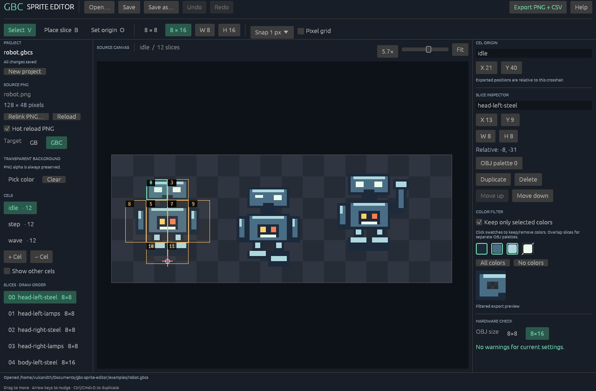

# GBC Sprite Editor

An offline desktop editor for slicing existing PNG artwork into **Game Boy and Game Boy Color sprites**. Put slices wherever the artwork needs them, overlap them for palette layers, and export ordinary PNGs plus CSV descriptions for your existing build tools.

Built in Rust with `egui` / `eframe`. The application runs locally on Linux, Windows, and macOS; it has no account, server, or network requirement.



## What it does

- Free placement of 8×8, 8×16, and custom-size slices; optional snapping, selection, dragging, duplication, and keyboard nudging.
- Multiple named cels, each with its own origin and slices.
- Exact RGB color masks on individual slices, palette numbers, and a project-wide transparent color key for layered objects.
- PNG hot reload while you draw in another application.
- Undo and redo, editable slice properties, and human-readable CSV project files.
- Export a tile atlas, individual slice PNGs, and CSV tables with source coordinates, origin-relative object positions, tile indices, and palette metadata.
- Headless command-line export for build scripts.

This is a slicing and layout editor. Paint and recolor the source PNG in your preferred pixel editor, then reload it here.

## Run it

Download the archive for your platform from [Releases](https://github.com/vulcandth/gbc-sprite-editor/releases). Development builds are also attached to successful **Actions → CI** runs.

| Platform | Archive | Start |
| --- | --- | --- |
| Linux x86-64 | `gbc-sprite-editor-linux-x86_64.tar.gz` | Extract and run `./gbc-sprite-editor` |
| Windows x86-64 | `gbc-sprite-editor-windows-x86_64.zip` | Extract and run `gbc-sprite-editor.exe` |
| macOS Apple Silicon | `gbc-sprite-editor-macos-aarch64.zip` | Extract and open `GBC Sprite Editor.app` |
| macOS Intel | `gbc-sprite-editor-macos-x86_64.zip` | Extract and open `GBC Sprite Editor.app` |

Linux release binaries are built on Ubuntu 24.04 and require glibc 2.39 or newer, a working X11 or Wayland desktop, and OpenGL. Build from source for older distributions. Native file dialogs on Linux use the desktop's XDG portal service. macOS packages target macOS 11 or later and have an ad-hoc signature, not Apple notarization; downloaded builds may need approval through macOS Privacy & Security. Windows builds are not code signed. The Windows x64 executable requires Windows 10 or later and the [Microsoft Visual C++ v14 x64 Redistributable](https://learn.microsoft.com/en-us/cpp/windows/latest-supported-vc-redist); install it if Windows reports a missing `VCRUNTIME140.dll`. The editor itself works offline.

### Build from source

Install a current stable [Rust toolchain](https://www.rust-lang.org/tools/install) (Rust 1.92 or later). The first build downloads dependencies; the resulting application works offline.

On Debian/Ubuntu, install the desktop development libraries:

```sh
sudo apt-get install pkg-config libxkbcommon-dev libwayland-dev libx11-dev \
  libxrandr-dev libxi-dev libxcursor-dev libxinerama-dev libgl1-mesa-dev
```

Windows needs the Visual Studio C++ build tools; macOS needs the Xcode command-line tools (`xcode-select --install`). Then, from the repository:

```sh
cargo run --locked --release
cargo run --locked --release -- examples/robot.gbcs
cargo run --locked --release -- path/to/sprites.png
```

The compiled executable is in `target/release/`.

The original robot artwork and project in `examples/` demonstrate non-grid placement, several cels, origins, and overlapping color layers. Windows builds retain a console so command-line export and its diagnostics work normally.

## A typical session

1. **Open…** and choose the source artwork. Enable **Hot reload PNG** to pick up saves from your pixel editor.
2. Add a cel and give it a useful name, such as `walk_0`.
3. Choose **Place slice**, select an 8×8, 8×16, or custom size, and click to place slices. Slices can overlap and do not need to follow a grid.
4. Choose **Select** to move a slice or edit its numeric coordinates and dimensions. Duplicate a slice to make an overlapping color layer.
5. Set a cel origin with **Set origin**, or enter its coordinates. For palette layers, enable **Keep only selected colors** and select the source colors it should retain.
6. **Save** as `.gbcs`. Keep the project and its referenced PNG together when moving them.
7. **Export** to a new or empty directory. Choose one hardware object height, 8 or 16 pixels, and the atlas width in 8×8 tiles.

The original PNG is never changed by slicing or exporting. A project stores the source path and editing metadata, not a copy of the source pixels.

### Controls

Use **Cmd** in place of **Ctrl** on macOS. Shortcuts operate on the canvas when a text field is not being edited.

| Input | Action |
| --- | --- |
| Ctrl/Cmd+O | Open a PNG or project |
| Ctrl/Cmd+S | Save project |
| Ctrl/Cmd+Shift+S | Save project as |
| Ctrl/Cmd+Z / Ctrl/Cmd+Shift+Z | Undo / redo |
| Ctrl/Cmd+D | Duplicate selected slice |
| Delete | Delete selected slice |
| Arrow keys / Shift+arrows | Nudge selection by 1 / 8 pixels |
| V / B / O | Select / slice / origin tool |
| Scroll | Pan canvas |
| Zoom slider | Change pixel zoom |

## Coordinates and palettes

Source coordinates are integer pixels with **x increasing rightward and y downward**. A cel origin is also a position in the source image. Exported placement is the slice or hardware object's top-left **minus the cel origin**, so negative positions are valid.

For example, a slice at `(30, 32)` with cel origin `(37, 48)` exports at `(-7, -16)`. These positions do not include a runtime screen position or the Game Boy's OAM coordinate biases (`+8` for x and `+16` for y). Add those in your game's exporter or renderer.

A slice color mask keeps only explicitly selected **RGB** values; every other color becomes transparent. An enabled, empty mask keeps no colors. Disabling the mask keeps all source colors. Existing alpha is preserved for retained pixels; the optional global color key makes matching RGB pixels fully transparent. Masks match exact RGB values, without tolerance or quantization.

Palette numbers are annotations for your game pipeline. They do not recolor pixels or automatically assign hardware color indices. Overlapping slices with disjoint masks let you split one painted cel into several OBJ palettes.

## Project format (`.gbcs`)

Projects use a versioned, tagged CSV format. The first field identifies the record type; there is no JSON dependency in the file format. For example:

```csv
gbc_sprite_project,1
image,sprites.png
target,cgb
transparent,
cel,0,walk_0,37,48
slice,0,body,30,32,8,16,0,*
slice,0,highlight,30,32,8,16,1,FFFFFF;A8D878
```

| Record | Fields after the record type |
| --- | --- |
| `gbc_sprite_project` | Format version (`1`) |
| `image` | PNG path, relative to the project file or absolute |
| `target` | `dmg` or `cgb` |
| `transparent` | Global RGB color key as `RRGGBB`, or empty to disable |
| `cel` | Cel index, name, source origin x, source origin y |
| `slice` | Cel index, name, source x, source y, width, height, palette, color mask |

The `image`, `target`, and `transparent` records are required. Cel indices are contiguous from zero, and slices refer to those indices. A color mask is `*` for all colors, an empty field for no colors, or semicolon-separated `RRGGBB` values. Hex colors are case-insensitive on load and saved in uppercase. Standard CSV quoting supports punctuation and newlines in names and paths.

Saving writes the PNG path relative to the project directory where possible; **Save As** recalculates it for the new location. Cel and slice names are limited to 256 Unicode characters. Slice dimensions range from 1 to 256 pixels. Palette numbers are 0–1 for DMG and 0–7 for CGB. No artwork pixels are embedded in the project.

## Export format

Exports use PNG and UTF-8 CSV with header rows. Names containing commas, quotes, or newlines follow standard CSV quoting. All indices start at zero. Exporting requires a new or empty directory so existing assets are not silently replaced.

| File | Contents |
| --- | --- |
| `tiles.png` | Atlas of 8×8 tiles, read left-to-right and then top-to-bottom |
| `objects.csv` | Hardware-sized objects with cel/slice identity, source coordinates, relative placement, tile index, palette, and dimensions |
| `slices.csv` | Slice source rectangles, origins, relative placement, tile/object ranges, masks, and individual PNG paths |
| `cels.csv` | Cel origins and exported ranges |
| `palettes.csv` | Per-slice palette metadata and allowed colors |
| `slices/0000-0000.png`, … | Individual masked slice images at their requested dimensions |

`objects.csv` has these columns:

```csv
object_index,cel_index,cel_name,slice_index,slice_name,source_x,source_y,x,y,tile_index,palette,width,height
```

Each slice is split into hardware objects from left to right, then top to bottom. In **8×16 mode**, an object's upper tile is immediately followed by its lower tile in the atlas's **linear tile order**; each pair starts on an even tile index. The two tiles need not appear vertically adjacent in the PNG. A converter that reads 8×8 tiles in row-major order preserves the required pair order.

For tile index `n` and atlas width `W` tiles, its atlas pixel position is `((n % W) * 8, (n / W) * 8)`, using integer division. `tile_index` identifies this exported tile stream, not an assigned VRAM address or bank. There is no tile deduplication, flip optimization, or VRAM packing.

The remaining table headers are:

```csv
# slices.csv
cel_index,cel_name,slice_index,slice_name,source_x,source_y,width,height,origin_x,origin_y,offset_x,offset_y,palette,first_tile_index,tile_count,first_object_index,object_count,color_mask,png
# cels.csv
cel_index,cel_name,origin_x,origin_y,first_object_index,object_count,first_tile_index,tile_count
# palettes.csv
cel_index,cel_name,slice_index,slice_name,palette,mask,color_index,r,g,b
```

The comment lines above identify files and are not present in the exported CSVs. In `palettes.csv`, `mask` is `all`, `none`, or `allowlist`. An `all`/`none` row has empty color fields; each `allowlist` row describes one retained RGB value. `color_index` numbers mask entries, **not hardware color indices**.

In the atlas, custom rectangles are padded to whole 8×8 or 8×16 objects; individual slice PNGs retain their requested sizes. Samples outside the source image become transparent. Export preserves source colors and alpha. The atlas is RGBA PNG; it is not a hardware-indexed image or a `.2bpp` file. Unused cells at the end of the last atlas row are transparent and are not included in CSV tile counts.

### Hardware checks

The editor validates palette numbers and reports likely hardware problems, including more than three visible RGB colors per object or shared palette within a cel, partial alpha, more than 40 objects in one cel, more than ten objects intersecting a scanline, and out-of-image slices. Warnings do not automatically alter the art.

**An export never mixes 8×8 and 8×16 hardware objects.** The toolbar's **All OBJs** setting selects one size for every cel, as required by [Pan Docs: LCDC.2](https://github.com/gbdev/pandocs/blob/master/src/LCDC.md#lcdc2--obj-size). Source cutout sizes may differ: an 8×16 cutout becomes two objects in 8×8 mode; an 8×8 cutout becomes one transparently padded object in 8×16 mode. The inspector shows the resulting object count and padding.

Object height is global for an export, matching the GB/CGB hardware's global 8×8 or 8×16 OBJ mode. Hardware color conversion, screen clipping, OAM ordering/priority, VRAM allocation, and interaction with other sprites remain your game's responsibility. A cel-level check cannot account for other cels displayed at the same time.

### Command-line export

```sh
gbc-sprite-editor --export path/to/project.gbcs robot-export \
  --object-height 16 --tiles-per-row 16
```

Or run the same operation from source:

```sh
cargo run --locked --release -- --export examples/robot.gbcs robot-export \
  --object-height 16 --tiles-per-row 16
```

The output directory must be new or empty, and its parent directory must already exist. On macOS, the executable inside the app is `GBC Sprite Editor.app/Contents/MacOS/gbc-sprite-editor`. Quote this path when using it in a terminal. `--help` lists supported arguments. Export defaults to 8×16 objects and a 16-tile-wide atlas. It accepts object heights of 8 or 16, atlas widths of 1–256 tiles, and at most 65,536 tiles per export. Atlas height is capped at 65,536 pixels; widen the atlas if a large export exceeds that limit.

## Development and releases

```sh
cargo fmt --all --check
cargo clippy --locked --all-targets -- -D warnings
cargo test --locked --all-targets
cargo build --locked --release
```

CI runs formatting and Clippy checks, then tests, builds, and packages native executables on Linux, Windows, macOS Apple Silicon, and macOS Intel. These build checks do not replace testing the GUI on each desktop. Pushing a `v*` tag runs the same checks and publishes the four archives and SHA-256 checksums as a GitHub Release. The release workflow uses only the repository's `GITHUB_TOKEN`.

There is no `.ec` import, automatic sprite detection, animation playback, pixel painting, palette quantization, or binary tile conversion. PNG decoding is bounded to 8,192 pixels per dimension and 16 megapixels total.

## Inspiration and license

Inspired by the workflow described in [pinobatch's `extractcels.py`](https://github.com/pinobatch/libbet/blob/master/tools/extractcels.py) and [LiSprEd](https://github.com/nummacway/LiSprEd). This is an independent implementation; no code or artwork was copied from those projects.

[MIT licensed](LICENSE). Rust dependencies retain their own licenses.
